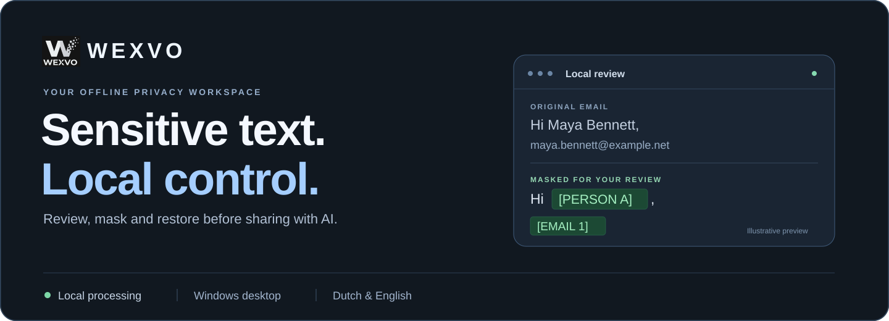
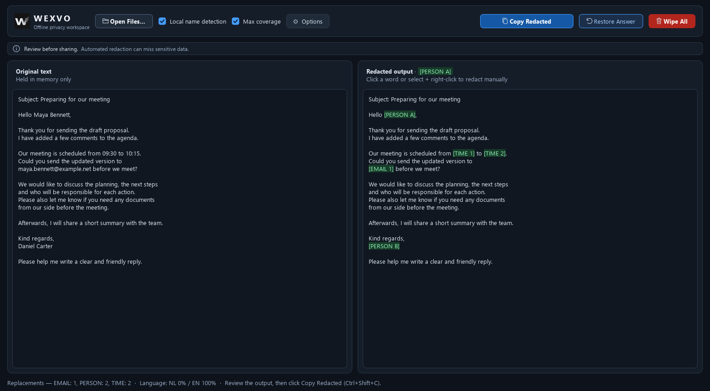
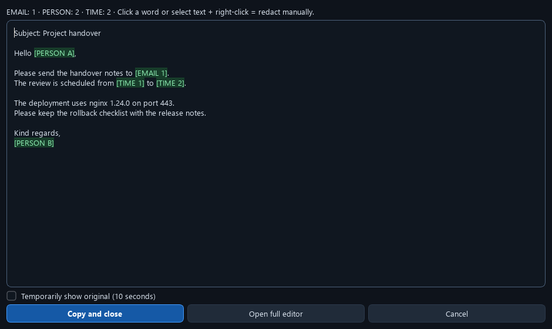
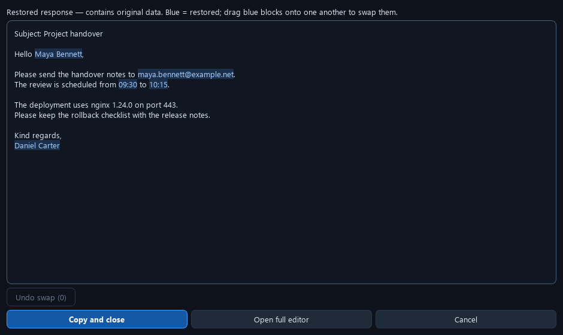

  

<strong>Offline by design.</strong> Human review before sharing.

  <a href="#watch-the-workflow">Video</a> &nbsp;·&nbsp;
  <a href="#see-wexvo-in-action">Preview</a> &nbsp;·&nbsp;
  <a href="#a-small-step-before-you-share">How it works</a> &nbsp;·&nbsp;
  <a href="#everyday-controls">Controls</a> &nbsp;·&nbsp;
  <a href="#privacy-with-clear-boundaries">Privacy</a> &nbsp;·&nbsp;
  <a href="#validation-and-current-status">Validation</a>

---

Wexvo helps you prepare sensitive text before pasting it into an AI assistant. It replaces detected identities with placeholders, keeps the result available for review, and can restore known placeholders in the answer using the active session.

Built for Windows, with local Dutch and English detection and a practical workflow for technical logs, correspondence and document text.

> **Private beta.** Automated detection can miss sensitive data or mask useful context. Always review before sharing.

## Watch the workflow

**36 seconds · Real ChatGPT reply · English captions · No audio**

https://github.com/user-attachments/assets/799c87f6-0f0b-4cf9-8cb5-5ed45c2f6072

An ordinary email → green placeholders → ChatGPT → copy the answer twice → review restored values in blue → copy the finished email.

[Download the MP4](assets/wexvo-chatgpt-workflow.mp4) · [Manual corrections, swaps and undo](assets/wexvo-walkthrough.mp4) · [Read the steps](#a-small-step-before-you-share)

An edited demonstration with fictional email text, an actual ChatGPT response and the running Wexvo interface. Only the masked email was sent to ChatGPT. Wexvo performs masking and restoration locally.

About this recording

The browser and Wexvo were captured separately, with isolated clipboards, to avoid recording or changing the user's desktop. The exact copied ChatGPT response was transferred to the demo session, where real Qt copy events opened the restore review using the previously confirmed mapping. Captions, keyboard hints and cuts were added. This is a workflow demonstration, not a continuous recording or an end-to-end Windows clipboard compatibility test.

## See Wexvo in action

  

An everyday email: original text on the left, reviewed output on the right.

<table>
  <tr>
    <td width="50%" valign="top">
      <h3>Review what leaves your device</h3>
      
      
Inspect green placeholders, add manual redactions and confirm when you are ready.

    </td>
    <td width="50%" valign="top">
      <h3>Review what comes back</h3>
      
      
Inspect restored values in blue. Swap blocks when needed, then explicitly copy the answer.

    </td>
  </tr>
</table>

Actual application captures, rendered offscreen with newly written fictional examples. The header is an illustration. No private documents or real contact details are shown.

## A small step before you share

| 1 · Copy twice | 2 · Review locally | 3 · Confirm and paste |
| :--- | :--- | :--- |
| Select text and press **Ctrl+C twice** in quick succession. | Check the masked result. Click a word to redact it everywhere, or select text and choose **Redact everywhere**. | Choose **Copy and close**, or press **Ctrl+Enter**. Then paste into your chosen application. |

**For the return journey:** copy an AI answer containing Wexvo placeholders twice. Wexvo shows the restored answer for review when the relevant mapping is available. Confirm to copy it back to your document.

Keep the same Wexvo session open throughout the round trip. Unknown or unavailable placeholders cannot be reconstructed; they require attention rather than guessed values.

Double Copy starts enabled, with a default interval of **600 ms**. Adjust it or turn it off in **Options → Double Copy…**. These choices last only until Wexvo closes. Detection relies on clipboard updates, so behaviour can vary between applications.

## Made for useful context

| Everyday text | Technical output | Document workflows |
| :--- | :--- | :--- |
| Review names, contact details, addresses and identifiers in correspondence. | Mask network identities and credentials while aiming to preserve services, ports, software versions and CVE references. | Import text from TXT, Word, PowerPoint, Excel, PDF and supported images, with local OCR where needed. |

**Manual corrections stay close to the text.** Use **Undo Manual** to reverse a manual redaction. Restored blue blocks can be dragged onto one another to swap values; **Undo swap** reverses the last swap.

**More room when you need it.** Choose **Open full editor** to carry the current review into the full workspace without repeating the analysis. Copying in the full editor leaves it open.

Document import extracts text for review. It does **not** certify that the original file, its layout or its metadata has been permanently sanitised.

## Everyday controls

| Where | Action | Control |
| :--- | :--- | :--- |
| Any supported application | Open a compact review | Select text, then press **Ctrl+C twice** |
| Quick Review | Copy the reviewed result and close | **Ctrl+Enter** or **Copy and close** |
| Quick Review | Cancel without copying | **Esc** or **Cancel** |
| Full editor | Paste replacement input | **Ctrl+V** |
| Full editor | Copy the current redacted or restored result | **Ctrl+Shift+C** or the copy button |
| Full editor | Use the existing Restore Answer action | **Ctrl+R** or **Restore Answer** |
| System tray | Show or hide the workspace | Left-click the Wexvo icon |
| Options | Configure optional Windows global hotkeys | **Global shortcuts…** |
| Options | Adjust Double Copy | **Double Copy…** |
| Options | Open the interactive introduction | **Quick tour…** |
| Tray menu | Exit completely | **Exit Wexvo Completely** |

**Global hotkeys are configurable, not a requirement.** Use the combinations shown in your current **Global shortcuts…** settings. Windows or another application may already reserve a combination. The tray icon and Double Copy provide alternative access.

<strong>Restore actions and clipboard behaviour</strong>

The recommended Double Copy workflow opens a review before copying redacted or restored text. **Copy and close** confirms that review; **Cancel** does not copy it. A pending redaction mapping is committed only on confirmation. Moving a pending review to the full editor does not itself commit it.

The existing **Restore Answer** button / **Ctrl+R** follows its separate editor workflow: it displays the answer and also copies successfully restored text. The optional **Blind Redact / Restore** action can update the clipboard without a review window. Choose Double Copy when you want to check the result before it reaches the clipboard.

## Privacy with clear boundaries

- **Local processing.** Detection and document processing use the bundled runtime and models. No AI account or remote inference service is required.
- **Session-only state.** Preferences and placeholder mappings live in memory. Closing Wexvo or choosing **Wipe All** removes the application's session state; the safety timer can also expire review or clipboard data.
- **Explicit sharing.** You decide which reviewed content to paste into another application. Masking identifiers does not remove every kind of confidential information or determine whether sharing is permitted.
- **No forensic promise.** Application cleanup cannot guarantee that Windows paging, crash dumps, clipboard tools or other software retain no copies. The single-file Windows build temporarily extracts its runtime; the portable-folder build avoids that extraction.

## Validation and current status

**Current local build: 1.1.8 · Verified 27 October 2026**

| Verification | Recorded result |
| :--- | :--- |
| Unit suite | **385 tests per configuration**, passed with source and native cores, Max coverage on and off |
| Full regression matrix | **86 jobs passed**: 54 detection jobs, 28 GUI jobs and 4 unit-suite jobs |
| Windows packages | Both single-file and portable EXEs passed **--selftest** |
| Packaging checks | Ten native core modules in each package; bundled lexicon resources verified |
| Temporary extraction | Single-file extraction removed after selftest; portable selftest created no extraction directory |

These are recorded local results, **not live CI, an independent certification or a guarantee of perfect detection**. Earlier GUI failures were retained and investigated; final checks passed after the test desktop binding was corrected, without changing their assertions or keyboard input.

<strong>Known detection limitations and external evaluation</strong>

The latest build fixes specific false positives in education/correspondence context and the missed start of clock-time ranges. It does not eliminate all detection errors.

An existing benchmark of **77 externally sourced, openly licensed fictional emails** was rechecked in both detection modes with fresh and shared sessions. On the reviewed fragments, **70 unwanted masks in the development split and 80 in the previously reviewed holdout remain**, alongside **8 incomplete known full-name occurrences in development and 0 in holdout**. Restore round-trip failures were zero. These counts are not document-level error rates or overall precision/recall; the annotations are partial, and this reused holdout is a regression set rather than a new independent evaluation.

Those accuracy audits still report failure. They are separate from the passing technical regression matrix. Neither the screenshots nor the regression totals establish that the tool is ready for unattended handling of confidential documents.

## Project

**Windows · Python · PySide6 · spaCy · Regex · ONNX Runtime · Cython/MSVC · PyInstaller**

Wexvo is under private development. This repository currently contains the project presentation and visual assets; application source code and executables are not published here. No public download or open-source licence is announced.

Next priorities: independent evaluation, clean-machine Windows checks and usability feedback from realistic workflows.

---

Wexvo · Sensitive text. Local control.

